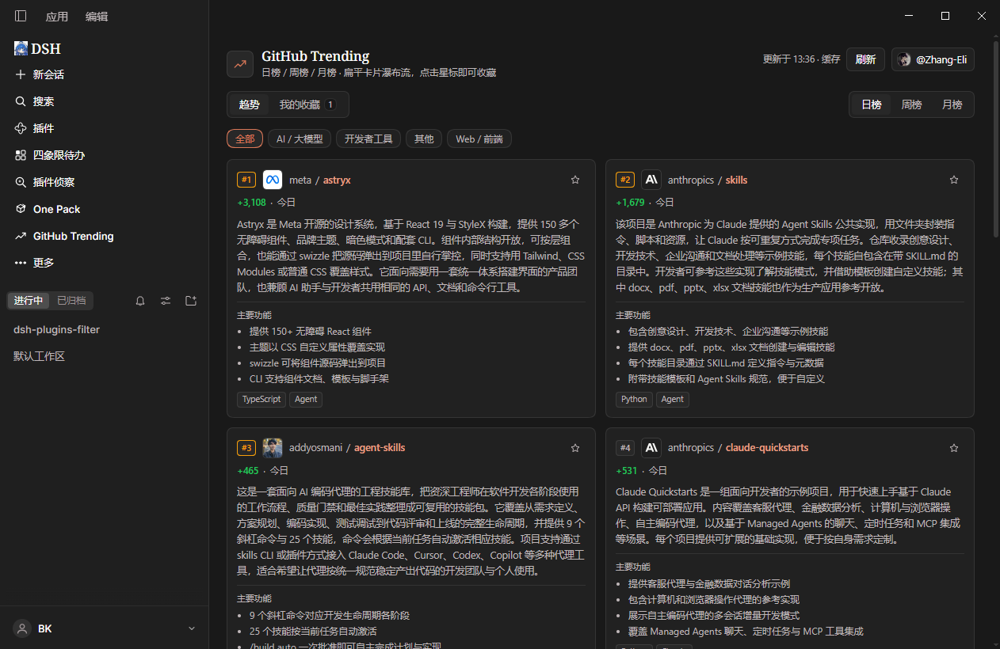

# GitHub Trending (DSH plugin)

[English](README.md) | [中文](README.zh.md)

Browse GitHub Trending's daily, weekly and monthly boards in a masonry layout, with one-click starring that syncs to GitHub.



## What it does

- **Daily / weekly / monthly boards**: GitHub Trending's three time windows, one tab switch apart.
- **A readable introduction for every project**: the Harness model (your current default model, no extra API key) writes a fluent 2-4 sentence introduction plus 3-4 highlight bullets that explain what the project is and what it solves — written for readers, not copied from the README.
- **Speaks your UI language**: a Chinese panel gets Chinese introductions, an English panel gets English ones, so cards match the interface around them.
- **Masonry cards**: responsive columns where a longer introduction simply makes a taller card, and the whole board scrolls as one page.
- **Instant tab switches**: once the visible board loads, the other two are readied in the background; reopening the panel paints the last content immediately, and the refresh button is there when you want live data.
- **One-click star**: connect a GitHub account (Personal Access Token) and the star lands on your real account; without an account it is kept in "我的收藏" and survives restarts.
- **Only what matters on a card**: the introduction, the tech stack, the period tag and the category chips.

## Install

```sh
dsh plugin --profile desktop add dsh-github-trending-masonry
```

Restart DSH, then click the trending icon in the sidebar icon list to open the panel.

## Using it

- Click the trending icon in the sidebar → the panel opens in the main column.
- Switch **日榜 / 周榜 / 月榜** at the top, filter by the category chips, click a card's top-right star to star the project.
- **我的收藏** lists everything you starred, newest first: a `GitHub` badge means it was synced to your real account, a `本地` badge means it lives only on this machine.
- The account button in the header lets you **connect GitHub**: paste a Personal Access Token (a classic token with the `public_repo` scope is enough to star public repositories), and from then on stars go straight to your GitHub account. Everything works without connecting too — the collection then stays local, and disconnecting never deletes it.

## Releases

### 0.1.0 — first public release

- Daily / weekly / monthly boards, masonry card layout, category filtering.
- Model-written introductions: a 2-4 sentence blurb plus 3-4 highlights, in your DSH UI language, cached per project.
- One-click star: synced to a connected GitHub account, or kept in "我的收藏" without one.
- Background prefetch and local caching: reopen the panel instantly, refresh for live data.

Detailed changes for later versions live in [CHANGELOG.md](CHANGELOG.md).

## Options

You normally do not need any of this. To change something, give the plugin a
config in the profile's `cordis.patch.yml`:

```yaml
- id: github-trending-masonry
  name: dsh-github-trending-masonry
  config:
    ttlMinutes: 30        # how long a board is cached, 5..1440, default 30 min
    summaries: true       # model-written intros; false = show translated README text
    summaryProvider: ''   # use a different model route
    summaryModel: ''      # use a different model
    summaryConcurrency: 6 # parallel model calls, 1..8
    summaryTimeoutMs: 60000
    dataDir: ''           # where caches and the collection are stored
    token: ''             # pin a token here instead of connecting in the UI
```

When no account is connected in the UI, the `GITHUB_TOKEN` / `GH_TOKEN`
environment variables are used as well.

## Data & privacy

- Board caches, introduction caches, your collection and the account metadata
  all live on this machine, under `plugin-data/github-trending-masonry/` in the
  profile directory.
- The GitHub token is stored in the DSH credentials service; if that service is
  unavailable it falls back to an owner-only JSON file on this machine. The
  token is never sent anywhere except GitHub itself.
- Introductions are generated through DSH's own model service, so you do not
  need an API key of your own.

## Good to know

- The first time a board loads, the model writes introductions, which costs a
  small amount of tokens (11-25 per board, and only for projects it has not seen
  yet); results are cached. Set `summaries: false` to turn this off entirely.
- The plugin only tracks stars it issued itself. Repositories you starred on
  GitHub before will show as unstarred on their cards — click once and it is
  correct again, and starring twice is harmless.
- If GitHub changes the Trending markup, the panel keeps showing the last cached
  board and recovers automatically once parsing is updated.

---

The approach to reading GitHub Trending was inspired by the MIT-licensed
`@royalsan/dsh-github-trending` plugin; this plugin is an independent
implementation with its own UI, data model and caching.